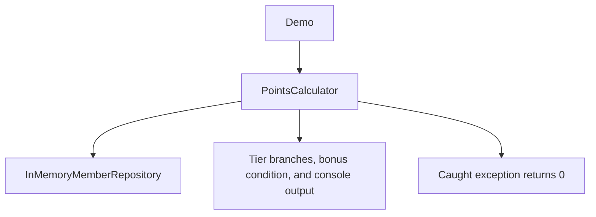
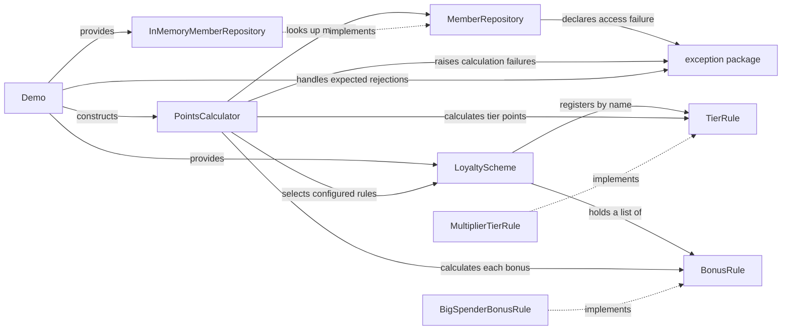
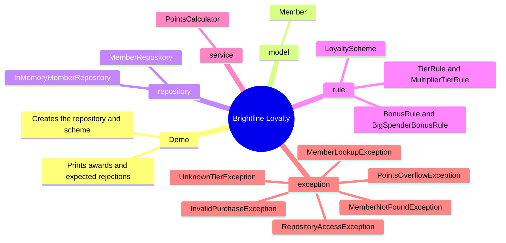

# Brightline Loyalty architecture

## Before

In the original starter (`fa5ba88`), `PointsCalculator` created its own in-memory repository and handled lookup, tier selection, arithmetic, bonus eligibility, and console output in one method. A broad catch returned zero on failure, the same value a valid purchase under GHS 10 could earn. The first refactoring commit (`b4cedd6`) injected the repository, which made it replaceable while leaving the reward policy and error handling inside the calculator.

## After

`Demo` is the entry point that constructs the repository and scheme, injects them into the calculator, and handles console output. `PointsCalculator` validates the request, looks up the member, selects the registered tier rule, calculates whole base points, and sums the tier and bonus results.

## Mind map

The `exception` package holds all six custom exception types. The repository interface
declares `RepositoryAccessException`. The calculator translates a declared storage
failure to `MemberLookupException` with its cause, and the demo catches the two
expected business rejections shown in its examples.

## Decisions and verification

| Concern | Decision and reason | Verification |
|---|---|---|
| Missing member and storage failure | `Optional.empty()` represents absence. The calculator translates a declared repository outage to `MemberLookupException` with the original cause. | Tests exercise both outcomes, plus a repository that violates its contract. |
| New membership tiers | `LoyaltyScheme` rejects duplicate names and allows callers to register any valid tier name. One multiplier implementation serves all default tiers. | Tests reject duplicate registrations and calculate points for a caller-configured PLATINUM tier. |
| Decimal and integer arithmetic | Use `BigDecimal` and round down before and after the tier multiplier as in the starter. Exact conversions and checked addition report overflow. | Tests verify fractional purchases, the largest supported STANDARD total, and overflow at each calculation step. |
| Bonus eligibility | Each bonus rule is evaluated independently. The default rule applies only above GHS 500. Keeping policies in Java suits the standalone lab and means changing default values requires a rebuild. | Tests exercise GHS 499.99, 500 and 500.01, plus multiple applicable bonuses. |

See [design rationale](RATIONALE.md) for alternatives and [verification results](docs/after-refactor.txt) for the observed test totals.
